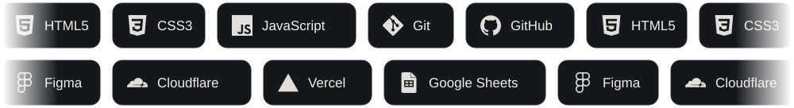

  

 

I'm a BSIT student from Cebu, Philippines. I build web interfaces and design them too: the layout and visuals first, then the code that makes them work. Right now I'm studying event-driven programming and software design patterns.

| | |
|:--|:--|
| **Focus** | Frontend development · Digital design |
| **Studying** | BSIT: event-driven programming, design patterns |
| **Portfolio** | [ckg-portfolio.contactclark20.workers.dev](https://ckg-portfolio.contactclark20.workers.dev/) |
| **Status** | Open to opportunities |

 

## Stack

  

 

## Selected work

| Project | Overview | Stack | Links |
|:--|:--|:--|:--|
| **Barangay Service System** | Web prototype for barangay services, deployed on Vercel | HTML · CSS · JavaScript | [Live](https://test-system-tawny.vercel.app) · [Source](https://github.com/ken-kaiser/test-system) |
| **Bato-Bato-Pick** | Rock-paper-scissors game | HTML · CSS | [Source](https://github.com/ken-kaiser/Bato-Bato-Pick) |
| **Observer Pattern** | Working demo of the Observer design pattern | HTML · JavaScript | [Source](https://github.com/ken-kaiser/Observer-Pattern) |
| **EVD Google Sheet** | Event-driven coursework project connected to Google Sheets | HTML · Google Sheets | [Source](https://github.com/ken-kaiser/EVD-Google-Sheet) |
| **EVD** | Event-driven programming coursework | HTML | [Source](https://github.com/ken-kaiser/EVD) |
| **Prototypee** | Interface prototype | HTML | [Source](https://github.com/ken-kaiser/Prototypee) |

<!--
COLLABORATIONS: add team projects as new rows above, and mark them like this:
| **Project name** | What it does · *Team project, my role: UI / frontend* | Stack | [Source](repo-url) |
-->

 

## GitHub activity

  
  

 

## Get in touch

